<p align="center">
  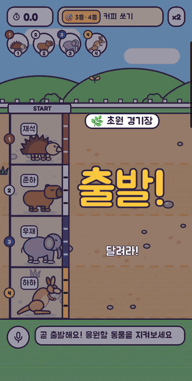
</p>

<h1 align="center">🏁 복불복 동물 레이스</h1>

<p align="center">
  <b>벌칙 걸고, 응원하고, 소리 지르는 20초짜리 동물 경주</b><br>
  
  
  
  
</p>

"꼴찌가 커피 쏘기" 같은 벌칙을 걸고, 각자 응원할 동물을 골라 경주시키는 복불복 게임이에요. 2~10마리가 달리고, 꼴찌로 들어온 동물에 탄 사람이 벌칙 당첨!

## ✨ 이런 게임이에요

- **🎬 역전 드라마** — 방해·실수·분발로 순위가 뒤집혀요. 끝날 때까지 아무도 몰라요.
- **🙋 사람이 주인공** — 동물마다 달릴 사람 이름을 붙이면 레인 이름표·해설·결과가 모두 이름으로. 최근 멤버·멤버 묶음으로 한 번에 불러오기.
- **🏟️ 경기장 4종** — 초원·해변·설원·사막 중 매 판 무작위, 경기장마다 넘어지는 장면도 달라요.
- **📤 결과 공유 카드 · 📒 우리 기록** — 결과를 이미지 한 장으로 단톡방에 보내고, 쌓인 판은 벌칙 왕·1등 왕·연속 당첨으로 모아 봐요.
- **🎯 랜덤 등수 & 💸 몰아주기 (번외)** — 출발 전 룰렛으로 당첨 등수를 뽑고, 여러 명이 걸리면 미니게임으로 한 명에게 몰빵.
- **🐾 동물 20종 도감 · 🔊 효과음 · 🎵 배경음악**
- **🎲 완전 공정** — 최종 순위는 출발하는 순간 균등 무작위로 정해져요. 스킬·역전·이름·경기장은 모두 연출이라, 어떤 동물이든 모든 순위에 같은 확률로 와요. ([검증 결과](docs/fairness.md))

## 🎮 이렇게 놀아요

| ① 누가 달려요? | ② 룰렛 → 출발! | ③ 당첨 발표 → 공유 |
|:-:|:-:|:-:|
| 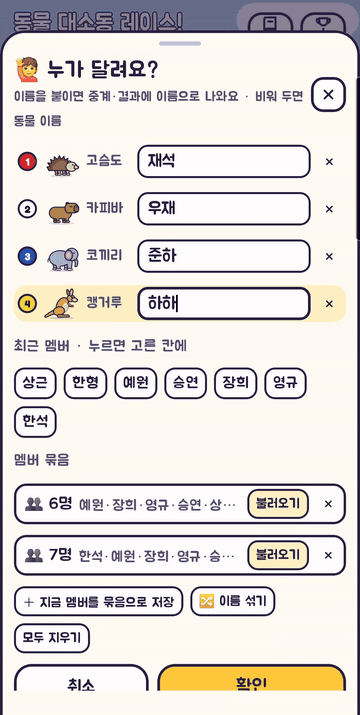 | 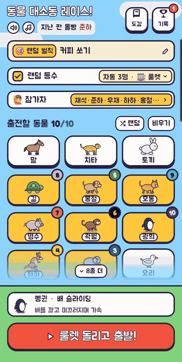 | 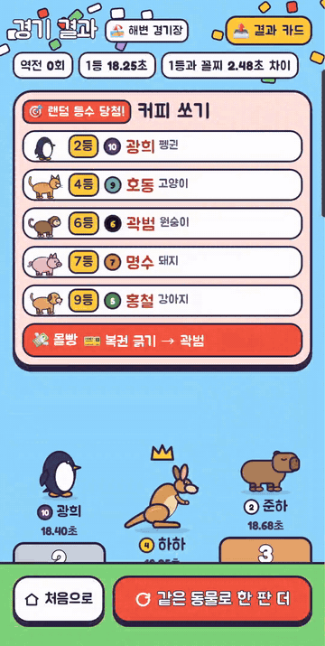 |
| 동물을 고르고 🙋 참가자에서<br>이름 붙이기 · 멤버 묶음 불러오기 | 랜덤 등수를 켜면 당첨 등수 룰렛,<br>끄면 꼴찌 벌칙으로 바로 출발 | 사람 이름으로 당첨 발표,<br>📤 결과 카드로 단톡방에 |

## 🏟️ 경기장마다 다른 해프닝

순위와 멈춤 시간은 그대로, 넘어지는 장면만 경기장에 맞게 달라요.

| 🌿 초원 · 돌부리에 데굴 꽈당 | 🏖️ 해변 · 파도가 철썩 |
|:-:|:-:|
| 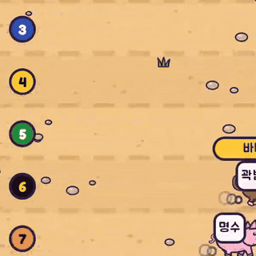 | 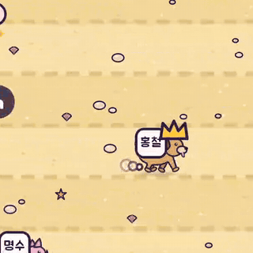 |
| **❄️ 설원 · 눈더미에 머리부터 푹** | **🌵 사막 · 모래 회오리에 빙글** |
| 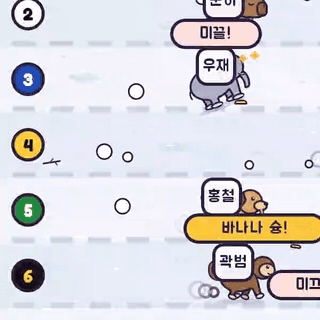 | 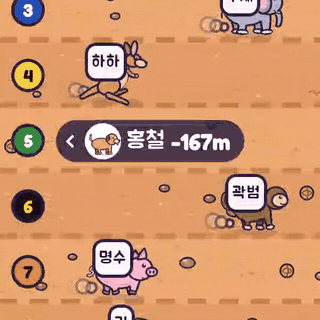 |

## 📒 우리 기록

| 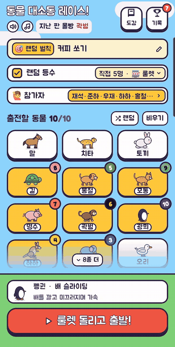 | 이름을 붙여 달린 판만 모아 우리끼리 순위를 보여 줘요.<br><br>☕ **벌칙 왕** — 걸린 횟수 / 달린 판<br>🔥 **연속 당첨** · 🏆 **1등 왕** · 🧾 **최근 5판 벌칙**<br>이번 주 · 이번 달 · 전체, 👥 멤버 묶음별로<br><br>옆 탭 **최근 경기**에는 최근 200판의 순위·벌칙·경기장이 남아요.<br>"이 동물이 유리하다"로 읽힐 동물 통계는 넣지 않았어요. |
|:-:|---|

## 🎯 번외: 랜덤 등수 & 몰아주기

메인에서 **랜덤 등수**를 켜면 꼴찌 대신 룰렛으로 당첨 등수를 뽑아요(위 ②). 여러 명이 걸리면 결과 화면의 [💸 몰아주기!]로 걸린 사람끼리 한 판 더 해서 한 명에게 몰빵!

| 🪜 사다리 타기 | 🎫 복권 긁기 | 🎰 가챠 캡슐 |
|:-:|:-:|:-:|
| 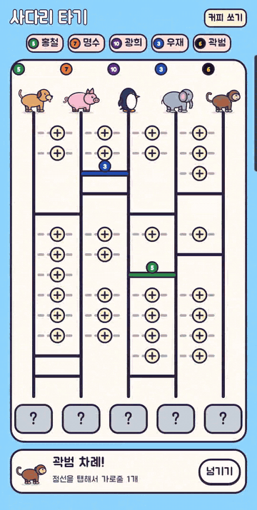 | 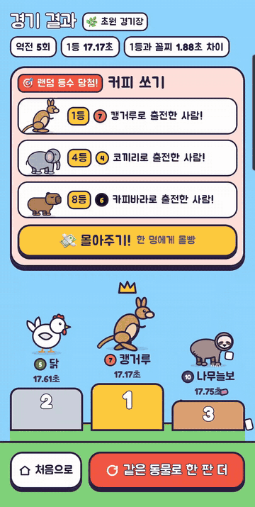 | 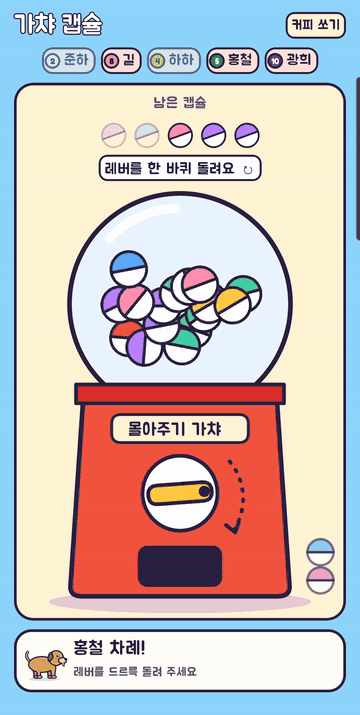 |
| 한 사람당 가로줄 1개 긋고 출발 | 사람 수 × 3장(5명부터 × 2)을<br>몰빵이 나올 때까지 돌아가며 긁기 | 레버 돌려 나온 캡슐을 톡톡<br>(복권과 같이 3바퀴) |

몰빵할 사람은 게임 전에 고르게 뽑아 두고 게임은 그걸 보여 주는 연출이라, 누가 먼저 하든 걸릴 확률은 같아요.

## 🗓️ 이렇게 자라 왔어요

| 버전 | 큰 변화 |
|:-:|---|
| **1.0** | **첫 완성** — 동물 14종과 고유 스킬, 메인·경주·결과 화면 |
| **2.0** | **카메라가 따라가는 경주** — 한 화면에서 동물 고르기, 선두 무리를 따라가며 확대·축소하는 카메라 |
| **2.1** | **완전 공정 엔진** — 순위는 출발 때 균등 무작위, 스킬은 연출만. 30만 판 카이제곱 검증 |
| **3.0** | **카툰 리디자인** — 직접 그린 캐릭터 일러스트, 스킬·피격 연출, 동물 도감 |
| **3.1** | **모든 역전에 보이는 이유** — 스토리보드 엔진: 큰 순위 변화는 눈에 보이는 방해·실수·분발로만 |
| **3.2** | **신규 캐릭터 6종** — 스컹크·고슴도치·카피바라·나무늘보·햄스터·판다 (총 20종) |
| **3.3** | **다리 다듬기** — 막대 다리 → 몸과 이어지고 아래로 가늘어지는 다리와 발 |
| **3.4** | **트랙 바닥 디테일** — 조약돌·풀 포기·발자국, 달리는 동물 뒤로 흙먼지 |
| **3.5** | **경기장 4종** — 초원·해변·설원·사막 무작위, 기록에 경기장 저장 |
| **3.6** | **경기장별 연출** — 혼자 넘어지는 장면이 경기장마다 달라요 |
| **3.7** | **나가기 확인창** — 경주 중 뒤로 가기 → 일시정지 + "아직 경기 중이에요!" |
| **3.8** | **새 앱 아이콘** — 체커 깃발 → 1등 왕관을 쓴 말 |
| **3.9** | **토끼굴 지름길** — 토끼 전용 가속: 굴로 쏙 → 땅속 두두두 → 앞쪽 굴에서 퐁! (낮잠은 실수 장면으로) |
| **3.10** | **랜덤 등수 모드 (번외)** — 출발 전 룰렛으로 당첨 등수 뽑기 → 경주 중 당첨 등수 표시 → 결과·기록에 당첨  |
| **3.11** | **몰아주기 미니게임** — 랜덤 등수로 2명 이상 걸리면 사다리 타기·복권 긁기로 한 명에게 몰빵  |
| **3.12** | **복권 긁기 v2** — 똑같이 생긴 복권을 출전 번호 순으로 한 장씩 골라 화면 가득 펼쳐 긁기 |
| **3.13** | **사다리 타기 v2** — 출전 번호 순으로 한 사람당 가로줄 1개 긋기 (넘기기 가능) |
| **3.14** | **미니게임 추가** — 🎰 가챠 캡슐 (함께 넣었던 🐊 악어 이빨은 3.18에서 뺌) |
| **3.15** | **🔊 효과음** — 경주·룰렛·미니게임 효과음 19종, 메인에서 켜기/끄기 |
| **3.16** | **🎵 배경음악** — 메인 "느긋한 오후", 경기 "전력 질주 8비트", 미니게임엔 은은하게 |
| **3.19** | **화면 다듬기** — 사다리 그을 자리 점선, 복권 크게, 진짜 출발 게이트 등 (실제 화면을 찍어 보고) |
| **3.20** | **랜덤 등수 직접 정하기** — 당첨 인원 조절, 걸릴 등수 미리 지정(룰렛 없이 출발) |
| **3.20.1** | 랜덤 등수 많을 때 룰렛 칸 3개씩 줄바꿈, 요약 칩 여백·줄임 |
| **3.21** | **사막 회오리 다시 그리기** — 겹겹 띠 만화 회오리, 흩어지는 모래 구름 |
| **3.21.1** | 사막 회오리 3.20.1 그림으로 되돌림 |
| **3.21.2** | 회오리 꼭대기를 뚜껑 대신 구멍으로, 말풍선 비킴 |
| **3.22** | **해변 파도가 진짜로 덮침** — 말리는 파도, 부서지는 거품, 젖은 토끼 |
| **3.23** | **설원: 눈더미에 머리부터 푹** — 미끄러져 처박혀 버둥 |
| **3.23.1** | 설원 해설 문구를 "눈더미에 푹" 장면에 맞춤 |
| **3.24** | **초원: 돌부리에 걸려 데굴** — 한 바퀴 굴러 꽈당, 머리 위 별 |
| **3.25** | **돼지·캥거루 다시 그리기** — 세모 귀·돼지꼬리, 긴 뒷발·굵은 꼬리 · 볼 홍조는 토끼·햄스터만 |
| **3.26** | **치타·판다 다시 그리기** — 눈물 줄무늬, 어깨를 감싸는 띠 · 펭귄 꼬리 |
| **3.26.1** | 판다 눈: 짙은 회색 패치 + 어두운 눈동자 |
| **3.27** | **햄스터 옆모습으로** — 볼주머니, 짧은 다리 네 개, 홍조 제거 |
| **3.28** | **오리·닭 다시 그리기** — 흰 오리, 부채 꼬리 닭, 굵은 다리 |
| **4.0** | **사람이 주인공** — 동물에 이름 붙이기 · 최근 멤버 · 멤버 묶음 · 이름으로 중계·결과 |
| **4.1** | **결과 공유 카드** — 당첨자 이름·시상대를 이미지 한 장으로, 단톡방 공유·사진 저장 |
| **4.2** | **우리 기록** — 기간·멤버 묶음별 벌칙 왕·1등 왕·연속 당첨·최근 벌칙 · 기록 200판 |
| **4.3** | **고슴도치 다시 그리기** — 둥근 끝 가시 두 겹, 통통한 몸, 큰 얼굴·눈 |
| **4.4** | **판다·나무늘보 옆얼굴** — 정면 얼굴 → 다른 동물처럼 오른쪽을 보는 옆모습 |
| **4.5** | **메인 정리** — 동물 순서 섞기(귀여운 동물 앞쪽), 랜덤 버튼 빼기, 도감은 첫 동물부터 · 칸 크기 맞춤 |
| **4.6** | **랜덤 등수 판은 당첨자에 집중** — 카메라·카드가 1등 대신 당첨 등수로 · 이름 창은 닫기만 해도 반영 |
| **4.7** | **복권 3바퀴** — 복권을 사람 수 × 3장으로(5명부터 × 2), 몰빵이 나올 때까지 돌아가며 · 많으면 네 칸 작은 복권 |
| **4.8** | **캡슐도 3바퀴** — 캡슐을 사람 수 × 3개로(5명부터 × 2), 몰빵이 나올 때까지 돌아가며 |
| **4.9** | **미니게임 순서는 자유** — 복권·캡슐은 자기 이름을 누르고 하기, 기록은 실제로 한 사람에게 |
| **4.9.1** | 복권을 누르자마자 "꽝 탈출"이 비치던 것 → 긁은 뒤에만 결과 표시 |
| **4.10** | **기록 한 판씩 지우기** — 카드마다 🗑 + 되돌리기, 기록 창은 최근 경기 탭 먼저 |
| **4.11** | **걸음별 달리기** — 질주·깡충·뒤뚱·종종·느릿 5가지 걸음, 빠르기에 맞춘 다리 박자 |
| **4.12** | **속도감** — 바닥 무늬 두 배·흐름 자국, 카메라 최대 250m, 빠르기 따라 흙먼지·스퍼트 바람 줄 |

---

<details>
<summary><b>📋 전체 패치노트</b> (버전별 자세히)</summary>

### 4.12 — 속도감 (캔버스 "💨 속도감 개선")
- 카메라가 선두를 따라가서 동물은 화면에 거의 멈춰 있고, 빠르기는 바닥이 흐르는 속도로만 느껴지는데 그 바닥이 1초에 화면의 14~45%밖에 안 흘러 느려 보이던 것 →
  - 🟫 **바닥 촘촘히**: 돌·풀·알갱이 두 배 + 레인마다 흐름 자국 두 줄 (트랙에 붙어 바닥과 같이 흐름)
  - 🎥 **덜 멀리 비추기**: 한 화면 최대 420m → **250m** · 뒤처진 동물은 화면 밖 "◀ -149m" 표시
  - 💨 **빠르기 따라**: 흙먼지가 빠를수록 크고 빠르게 뒤로 · 스퍼트 중엔 꼬리 뒤 하얀 바람 줄
- 화면 연출만 바뀌고 경주 결과·확률은 그대로 · `shot -Pscene=speed`로 확인

### 4.11 — 걸음별 달리기 (캔버스 "🏃 달리기 모션")
- 🏃 20종이 모두 같던 다리 흔들기 → **다섯 가지 걸음**
  - 질주 (말·치타·강아지·고양이): 다리를 크게 뻗고 모으며 몸이 앞뒤로 출렁
  - 깡충 (토끼·캥거루): 두 발 모아 높이 뛰고 착지 때 납작
  - 뒤뚱 (펭귄·오리·닭): 짧은 보폭에 몸을 기우뚱
  - 종종 (돼지·햄스터·고슴도치·스컹크·원숭이): 빠르고 짧게, 앞으로 숙임
  - 느릿 (거북이·나무늘보·달팽이·코끼리·판다·카피바라): 크고 느린 걸음
- ⏩ **빠르기 연동**: 스퍼트 땐 다리가 빨라지고(최대 약 1.7배), 느려지면 다리도 느려짐 (경주 엔진의 지금 빠르기를 화면 박자에만 씀 · 결과·확률 무관)
- `ui/art/Gait.kt` · `shot -Pscene=gaits`(20종 × 네 장면)로 확인

### 4.10 — 경기 기록 한 판씩 지우기 (캔버스 "🗑 경기 기록 한 판씩 지우기")
- 🗑 최근 경기 카드마다 오른쪽 위 지우기 버튼 → 그 판만 바로 지우고 **"#8 기록을 지웠어요 · 되돌리기"** (4초) → 되돌리면 원래 자리로
- 번호는 지운 뒤 빈 번호 없이 다시 매김 · 기록 배지·우리 기록 통계·"지난 판 꼴찌"도 함께 반영
- 전체 지우기는 오른쪽 위에서 목록 **맨 아래 "기록 모두 지우기"**로 (한 번 더 눌러야 지워짐)
- 📒 기록 창 탭 순서 **최근 경기 → 우리 기록**, 열면 최근 경기부터
- `HistoryDeleteTest` · `shot -Pscene=t-delete`로 확인

### 4.9.1 — 복권 결과는 긁은 뒤에만
- 🎫 복권을 누르는 순간 그 장이 바로 결과 면("꽝 탈출 + 이름")으로 바뀌어, 큰 복권이 펼쳐지는 사이로 비치던 버그 (몰빵 복권도 긁기 전엔 "꽝 탈출"로 보였음) → 결과 면은 **실제로 긁은 뒤에만**, 고르기만 한 장은 그대로 똑같은 복권
- `shot -Pscene=t-lotto`의 `3-opening`(펼쳐지는 중)으로 확인

### 4.9 — 미니게임 순서는 자유, 이름 누르고 하기 (캔버스 "🙋 미니게임 · 순서는 자유, 이름 누르고 하기")
- 실제로는 손에 잡히는 사람이 먼저 긁거나 뽑아서, 앱이 정한 "○○ 차례"와 달라 **몰빵 기록이 엉뚱한 사람에게 남던 문제** →
  - 🎫 복권 "누가 고를래요?" · 🎰 캡슐 "누가 돌릴래요?" + 이번 바퀴에 아직 안 한 사람의 이름 칩 → **자기 이름을 누르고** 진행, 기록은 누른 이름으로
  - 이름 없이 복권·레버부터 건드리면 칸이 빨개지며 "먼저 자기 이름을 눌러 주세요!" · 잘못 눌렀으면 [바꾸기]
  - 바퀴에 한 명만 남으면 이름 고르기 없이 바로 그 사람 차례 · 꽝 뒤 버튼은 "다음 사람 →" · 펼친 복권에 "○○의 복권"
- ⚖️ 한 바퀴에 한 사람 한 번씩이라 어떤 순서로 하든 걸릴 확률은 모두 같음 (`FreeTurnsTest`: 아무나 먼저·아무 장이나 고르는 경우 2·3·5명 χ² 검정)
- 🪜 사다리는 출발점마다 사람이 정해져 있어서 그대로
- `shot -Pscene=free-lotto` · `free-gacha` · `t-lotto` · `t-gacha-who`로 확인

### 4.8 — 가챠 캡슐도 3바퀴 (캔버스 "🎰 가챠 캡슐 · 3바퀴")
- 🎰 복권과 같은 규칙: 캡슐 **사람 수 × 3개** (5명부터 × 2개) · 몰빵이 나올 때까지 출전 번호 순으로 돌아가며 레버 돌리기 ("두 번째 바퀴 · 레버를 드르륵 돌려 주세요")
- 위쪽 "남은 캡슐" 줄: 9개까지 한 줄, 더 많으면 두 줄 · 기계 오른쪽 쓴 캡슐 더미는 최근 8개까지만
- 꽝이어도 남은 바퀴가 있으면 "꽝! 다음 바퀴에 또 와요", 마지막 바퀴의 꽝이어야 "꽝 탈출! 🎉" + 이름 칩 흐려짐
- ⚖️ 몰빵 캡슐 순번은 복권과 같은 숨긴 자리(`roundBomb`)를 게임 전에 뽑아 저장 · 사람마다 같은 개수라 걸릴 확률은 모두 같음 (`MiniGameTest.gachaRoundsGiveEveryoneTheSameCapsules`)
- 바퀴 규칙은 복권·캡슐이 함께 씀: `MiniGameDraw.rounds()` / `slots()`
- `shot -Pscene=gacha-2` (·3·5·8)로 확인

### 4.7 — 복권 긁기 3바퀴 (캔버스 "🎫 복권 긁기 · 3바퀴 + 4칸 격자")
- 🎫 금방 끝나던 복권 긁기 → 복권을 **사람 수 × 3장** (5명부터는 너무 길어져서 × 2장) · 몰빵이 나올 때까지 출전 번호 순으로 돌아가며 고름 ("두 번째 바퀴 · …", "세 번째 바퀴 · …")
- 평균 긁는 장수: 2명 1.5 → 3.5장, 3명 2 → 5장 · 2명 판이 첫 장에서 끝날 확률 50% → 약 17%
- 배치: 6·8·10장은 두 칸, 9·12장은 세 칸("🎫 복권"), 14장 이상은 **네 칸 작은 복권**(긁기 칸만, 긁으면 "꽝 + 이름")
- 위쪽 이름 칩은 **자기 복권을 다 긁어야** 탈출로 흐려짐 · 고른 복권을 크게 펼쳐 긁는 화면은 그대로
- ⚖️ 몰빵 복권 자리는 게임 전에 고르게 뽑아 저장(다른 게임으로 바꿔 열어도 그대로) · 누구나 같은 장수라 걸릴 확률은 모두 같음 (`MiniGameTest.lottoRoundsKeepEveryoneEqual`, 2·3·5명 × 두 가지 고르기 전략 χ² 검정)
- `shot -Pscene=lotto-2` (·3·4·5·8)로 확인

### 4.6 — 랜덤 등수 판은 당첨자에 집중 · 이름 창 자동 반영 (캔버스 "🎯 랜덤 등수 판 · 1등 대신 당첨자에 집중")
- 🎯 랜덤 등수 판에서 1등은 당첨이 아니면 의미가 없는데 "1등 골인!" 카드가 크게 떠서 헷갈리던 것 →
  - 📷 카메라가 1등 무리 대신 **지금 당첨 등수 자리에서 달리는 동물들**을 따라감 (그 자리가 바뀌면 카메라도 이동)
  - 1등은 결승선 "1등" 태그만 붙고 큰 카드 없이 지나감
  - 당첨 등수로 들어올 때마다 분홍 카드 **"🎯 3등 당첨!"** + 동물·이름·기록 (팡파레 대신 복권 "당첨" 소리)
  - 꼴찌 벌칙 판은 그대로 (1등 골인 카드 → 꼴찌 싸움)
- 🙋 "누가 달려요?" 창: 이름을 다 적고 창을 내리면 날아가던 것 → **어떻게 닫든**(완료·✕·아래로 내리기·바깥 누르기) 적은 이름이 그대로 반영 · [취소] 빼고 [완료] 하나
- `shot -Pscene=pick-focus`로 확인

### 4.5 — 메인 화면·도감 정리
- 🐰 메인·도감의 **동물 순서를 섞어** 귀여운 동물이 앞쪽에: 토끼·햄스터·판다 → 고양이·강아지·카피바라 → 펭귄·돼지·고슴도치 → 오리·말·나무늘보 → 닭·치타·거북이 → 코끼리·캥거루·원숭이 → 달팽이·스컹크 (`model/Animal.kt`의 `ANIMAL_ORDER`, 보여 주는 순서만 바뀌고 경주·확률과는 무관)
- "출전할 동물" 옆 **랜덤 버튼 제거** (비우기만 남김)
- 📖 도감은 늘 **첫 번째 동물(토끼)부터** 열림 (예전엔 아무것도 안 골랐으면 치타)
- 도감 아래 동물 칸: 마지막 줄이 6마리라 칸이 더 넓던 것 → **한 칸을 비우고 7칸 크기 똑같이**

### 4.4 — 판다·나무늘보 옆얼굴 (캔버스 "🐼🦥 판다 · 나무늘보 옆모습")
- 몸은 오른쪽으로 달리는데 얼굴만 정면이라 튀던 두 동물 → 다른 동물처럼 **오른쪽을 보는 옆얼굴** (몸·다리는 그대로)
- 🐼 판다: 흰 머리 + 앞으로 나온 주둥이 끝 코 · 귀 둘(먼 쪽은 뒤에 살짝) · 짙은 회색 눈 패치 하나 + 어두운 눈동자
- 🦥 나무늘보: 둥근 머리 + 주둥이 · 앞쪽 크림색 얼굴 · 눈에서 뒤로 이어지는 갈색 줄무늬 + 감은 눈 · 코 · 미소
- `shot -Pscene=faces`로 확인

### 4.3 — 고슴도치 더 귀엽게 (캔버스 "🦔 고슴도치 더 귀엽게")
- 🦔 뾰족한 삼각 가시 → **끝이 둥근 가시 두 겹** (진한 갈색 바깥 + 밝은 갈색 안쪽), 몸과 가시를 한 윤곽으로 합쳐 통통한 밤송이 모양
- 각진 주둥이·작은 눈 → **크고 동그란 얼굴** + 살짝 나온 주둥이, 반짝이 두 개 달린 큰 눈, 동그란 코, 작은 미소, 분홍 귀 속 · 아래 크림색 배
- 다리는 햄스터처럼 짧고 같은 모양 네 개 (먼 쪽 진하게) · 홍조 없음
- `shot -Pscene=hedgehog`로 확인

### 4.2 — 우리 기록 (캔버스 "🙋 4.0 사람이 주인공" ⑥)
- 📒 메인 [기록] 창에 **우리 기록 | 최근 경기** 탭 (이름 붙인 판이 있으면 우리 기록부터)
- 기간 칩 **이번 주 · 이번 달 · 전체** + 👥 멤버 묶음 칩(누를 때마다 모든 멤버 → 묶음1 → 묶음2 …)
- ☕ **벌칙 왕**: 사람마다 걸린 횟수/달린 판 막대 + 👑 · 총 판 수 · 가장 운 좋은 사람(걸린 비율이 가장 낮은 사람)
- 🔥 **연속 당첨**(지금 2판 이상 이어지는 사람) · 🏆 **1등 왕** · 🧾 **최근 5판 벌칙** 칩
- 몰아주기를 했으면 몰빵 당첨자만, 랜덤 등수는 당첨자 모두를 벌칙으로 셈 · 이름 없는 판은 세지 않음
- 동물별 승률처럼 "이 동물이 유리하다"로 읽힐 통계는 넣지 않음 · 아래에 "결과는 매판 공평한 무작위예요" 안내
- 기록 저장 10판 → **200판** (기록 배지는 99+까지)
- `StatsTest` · `shot -Pscene=ours`로 확인

### 4.1 — 결과 공유 카드 (캔버스 "🙋 4.0 사람이 주인공" ⑤)
- 📤 결과 화면 오른쪽 위 **결과 카드** → 카드 한 장 미리보기 + [🖼 사진 저장] [📤 공유하기]
- 카드: 날짜·경기장(경기장 색 하늘·언덕) · 오늘의 벌칙 · **당첨자 이름 크게** + 당첨 동물 · 1~3등 시상대 · 앱 이름
- 꼴찌 판은 "서연 당첨! · 돼지로 꼴찌 (4명 중 4등)", 랜덤 등수는 당첨자 모두, 몰아주기를 했으면 몰빵 당첨자 한 명
- 공유하기: 안드로이드 공유 창(카톡 등)으로 이미지 + 한 줄 글("🏁 동물 대소동 레이스 · 커피 쏘기 → 서연 당첨!")
- 사진 저장: 사진 › Pictures/AnimalRace (안드로이드 10 이상, 그 아래는 공유 창의 저장 기능 안내)
- `shot -Pscene=share-*` · `ShareTextTest`로 확인

### 4.0 — 사람이 주인공 (캔버스 "🙋 4.0 사람이 주인공" ①~④)
- 🙋 메인 화면 **참가자** 줄 → "누가 달려요?" 창에서 출전 동물마다 달릴 사람 이름 붙이기 (8자까지, 비워 두면 동물 이름)
- **최근 멤버** 칩(최근 12명, 누르면 고른 칸에 쏙 · 이미 탄 사람은 동물 표시) · **멤버 묶음** 저장/불러오기(최대 5개, 인원이 모자라면 동물을 자동으로 채움) · 🔀 이름 섞기
- 이름이 붙은 동물 칸은 동물 이름 대신 사람 이름표 · 모두 이름이 있으면 "N명 출발!"
- 🏁 경기 중 레인마다 이름표 · 해설·화면 밖 표시·1등 카드가 이름으로 ("지은 물보라에 눈을 못 뜨고 멈칫!")
- 🏆 결과: 벌칙 카드·당첨 카드에 **사람 이름 크게 + 동물 작게** · 시상대·전체 기록·미니게임·기록 화면도 이름으로
- ⚖️ 이름은 글자로만 쓰이고 순위·확률에는 전혀 영향 없음 (같은 난수면 같은 결과 — `PeopleTest`)
- 기록에 사람 이름이 함께 저장됨 · 멤버·묶음은 앱을 다시 켜도 남고, 동물별 이름은 선택처럼 매번 새로
- `shot -Pscene=people-*`로 확인

### 3.28 — 오리·닭 다시 그리기 (캔버스 "오리 · 닭 다듬기")
- 🦆 오리 (C안): 청둥오리 → **흰 오리** · 위로 들린 꼬리 + 말린 깃 · 앞이 둥글고 뒤로 뾰족한 날개 + 깃털 줄 · 주황 부리·물갈퀴 발 · 머리·목·몸을 한 도형으로 합쳐 윤곽선이 끊김 없이
- 🐔 닭: 토끼 귀처럼 솟던 테두리 꼬리 → 위쪽이 물결진 **부채 모양 꼬리** · 목을 이어 한 몸처럼 · 날개 모양 · 부리 크게 + 입 선 · 볏 조금 크게
- 공통: 눈처럼 보이던 흰 나뭇잎 날개 · 가는 선 다리 → 테두리 있는 굵은 다리 (오리 물갈퀴, 닭 발가락 세 개)
- `shot -Pscene=birds`로 확인

### 3.27 — 햄스터 옆모습으로 다시 그리기 (캔버스 "햄스터 다듬기" B)
- 🐹 몸은 옆인데 얼굴만 정면 + 몸만 한 머리로 부담스럽던 것 → 다른 동물처럼 **옆모습**, 머리가 몸에 묻힌 통통한 덩어리 + 볼록한 흰 볼주머니
- 제각각이던 발 → **같은 모양의 짧은 다리 네 개** (먼 쪽은 진하게, 발바닥 연분홍) · 머리 아래 흰 앞발 제거
- 등에 진한 털 무늬 · 콧수염 · 작은 꼬리 · 볼 홍조 제거 (이제 홍조는 토끼만)
- 1등 왕관 자리(`headTop`)를 새 머리에 맞춤 · `shot -Pscene=hamster`로 확인

### 3.26.1 — 판다 눈 순하게
- 🐼 흰 눈동자가 무서워 보이던 것 → 눈 패치는 **짙은 회색**, 눈동자는 어둡게 + 작은 흰 반짝이 (다른 동물 눈과 같은 방식)

### 3.26 — 치타·판다 다시 그리기, 펭귄 꼬리 (캔버스 "판다 · 펭귄 · 치타 다듬기")
- 🐆 치타: 점박이 곰 같던 둥근 머리 → 작고 납작한 머리 + 작은 반원 귀 · **눈물 줄무늬** · 테두리 없는 주둥이 · 점무늬 늘리고 다리에도 · 밝은 배 · 꼬리 끝 진한 고리
- 🐼 판다: 검은 상자 같던 어깨 → 몸 윤곽을 따라 **어깨를 감싸는 둥근 띠** (몸 윤곽선은 끊김 없이)
- 🐧 펭귄: 그림은 그대로, 몸 뒤 아래에 작은 꼬리를 바짝 붙임
- 치타 1등 왕관 자리(`headTop`)를 새 머리에 맞춤 · `shot -Pscene=trio`로 확인

### 3.25 — 돼지·캥거루 다시 그리기, 볼 홍조 정리 (캔버스 "돼지 · 캥거루 다듬기", "볼 홍조 비교")
- 🐷 돼지: 고깔모자 같던 뾰족 귀 하나 → 작은 세모 귀 두 개 · 눈처럼 보이던 고리 꼬리 → 꼬불꼬불 돼지꼬리 · 코 아래 미소 입 · 등 윤기·배 그늘 줄 · 머리를 낮춰 목 없는 체형 (코는 예전 그대로)
- 🦘 캥거루: 길쭉한 뒷발(달릴 때 엇갈림) · 뿌리가 굵고 땅을 짚는 꼬리 · 가슴 앞 짧은 팔 두 개 + 앞발 · 길쭉한 주둥이 + 코 + 입 · 귀 안쪽 분홍 · 허벅지 윤기
- 🌸 볼 홍조는 토끼·햄스터만 남기고 돼지·펭귄·고슴도치·판다(·캥거루)에서 뺌
- 1등 왕관 자리(`headTop`)도 새 머리 위치에 맞춤 · `shot -Pscene=duo`로 확인

### 3.24 — 초원: 돌부리에 걸려 데굴 (캔버스 "초원 연출 다듬기" ②)
- 🌿 헬멧처럼 보이던 큰 돌 + 얼굴에 붙은 별 → **작은 돌부리에 발이 걸려 "어어어~" 한 바퀴 데굴 → "꽈당!" 납작 엎어짐**
- 돌부리: 땅에 반쯤 묻힌 작은 돌 + 풀 · 구르는 동안 흙먼지 자국 · 엎어진 뒤 흙먼지가 퍼지며 작아짐
- 별은 얼굴 대신 머리 위를 빙글 (뒤로 갈 땐 작고 흐리게) · 풀잎이 팔랑팔랑 · 말풍선 왼쪽 위로
- 해설 문구도 장면에 맞게: "돌부리에 걸려 데굴데굴~ 꽈당!" 등 (개수 4개 그대로라 결과·확률 영향 없음)
- 이로써 4개 경기장 "혼자 넘어짐" 연출을 모두 새로 다듬음 · `shot -Pscene=meadow`로 확인

### 3.23.1 — 설원 해설 문구
- 설원 "혼자 넘어짐" 해설을 새 장면에 맞게: "빙판에서 미끄덩~ 눈더미에 머리부터 푹!", "얼음판을 쭉~ 미끄러져 눈더미에 처박혔어요!", "미끄덩 푹! 엉덩이만 나와서 버둥버둥", "눈더미에 푹 박혀 버둥버둥! 빠져나와요~" (개수 4개 그대로라 결과·확률 영향 없음)

### 3.23 — 설원: 눈더미에 머리부터 푹 (캔버스 "설원 연출 다듬기" ②)
- ❄️ 구름 모자처럼 보이던 "눈더미 와르르" → **빙판에서 휘청이며 쭉 미끄러져 앞 눈더미에 머리부터 푹! → 엉덩이·뒷다리만 나와 버둥**
- 빙판: 반짝이는 테두리 + 미끄러진 하얀 자국, 회색 바람 줄·네모 조각 대신 반짝이는 얼음 가루 ✦
- 처박힌 순간 눈 뭉치가 솟구쳐 작아지며 사라지고, 위에서 작은 눈 조각이 떨어짐 · 말풍선 "미끄덩~ → 푹!"은 왼쪽 위로
- 멈추는 시간·순위는 그대로 (그림만 바뀜) · `shot -Pscene=snow`로 확인

### 3.22 — 해변 파도가 진짜로 덮침 (캔버스 "해변 파도 다듬기" ②)
- 🌊 뒤에서 솟았다 가라앉기만 하던 파도 → **솟음 → 앞으로 말려 덮침 → "철썩!" 하얗게 부서짐 → 흠뻑 젖어 뚝뚝** (한 주기 1.8초)
- 새 파도 그림: 토끼 쪽으로 말리는 마루 + 안쪽 진한 관 + 뒤로 완만한 등·물결 줄, 물결무늬 거품 마루
- 덮치는 순간 토끼가 뒤로 밀리며 젖혀졌다 돌아옴 · 부서진 거품은 솟구쳐 작아지며 사라짐 · 물웅덩이는 덮친 뒤 넓게 생겼다 줄어듦
- 물방울: 하늘색 + 잉크 선 + 흰 반짝임으로 크게 · "철썩!" 말풍선은 왼쪽 위로 비켜 귀를 가리지 않게
- 멈추는 시간·순위는 그대로 (그림만 바뀜) · `shot -Pscene=wave`로 확인

### 3.21.2 — 회오리 꼭대기 구멍 (캔버스 "회오리 꼭대기 · 뚜껑 대신 구멍" ②)
- 🌪️ 예전 몸통은 그대로, 아이스크림 콘처럼 보이던 납작한 구름 뚜껑만 뺌 → **밝은 테두리 안쪽이 두 단계로 어두워지는 구멍**
- 구멍은 소용돌이 줄보다 나중에 그려 줄이 가로지르지 않게, 몸통보다 살짝 넓혀 위 양끝 뾰족한 데를 덮음
- "휘잉~" 말풍선을 회오리 오른쪽 위로 옮겨 토끼 얼굴을 가리지 않게

### 3.21.1 — 사막 회오리 되돌리기
- 3.21의 겹겹 띠 회오리를 빼고 3.20.1까지의 회오리 몸통으로 되돌림 (꼭대기 뚜껑 구름만 따로 다듬을 예정)

### 3.21 — 사막 회오리 다시 그리기 (캔버스 "사막 회오리 다듬기" A안)
- 🌪️ 아이스크림 콘처럼 보이던 회오리 → 꽉 찬 몸통에 **띠 9개가 겹겹이 감긴** 만화 회오리. 띠 위로 밝은 줄이 흘러 도는 느낌
- 꼭대기: 납작한 구름 뚜껑 대신 얇은 입구 + 양끝에서 모래 뭉치가 떨어져 나가며 흩어짐
- 바닥: 고정된 모래 언덕 대신 모래 구름이 양옆으로 굴러 나가며 작아짐 + 그림자 · 아래쪽일수록 크게 흔들림
- 토끼(등)는 몸통 앞에서 빙글빙글, 모래 띠 두 줄이 감싸며 지나감 · 돌멩이·회전초가 앞뒤로 돌며 깊이감 · 양옆 바람 줄
- "휘잉~" 말풍선은 회오리 오른쪽 위로 비켜서 얼굴을 가리지 않게
- 멈추는 시간·순위는 그대로 (그림만 바뀜) · `shot -Pscene=tornado`, `venue-trip`으로 확인

### 3.20.1 — 랜덤 등수 많을 때 화면 깨짐 수정
- 🎰 룰렛 칸이 4개 이상이면 오른쪽으로 잘리던 것 → 3칸씩 줄바꿈 (최대 9칸 = 3줄, 3줄일 땐 칸을 조금 낮게) · 발표 카드도 3개씩
- "딱!" 표시가 위쪽 숫자를 가리던 것 → 칸 모서리 밖에 비스듬히 걸치게
- 랜덤 등수 줄 오른쪽 요약 칩: 오른쪽만 넓던 여백을 위·아래·오른쪽 똑같이, 길면 줄임표
- 등수를 많이 고르면 글자가 넘치던 것 → 셋 이상은 "1·4·7등", 칩·경주 위쪽 표시는 "1·2·3등 외 6"으로 줄임
- 결과 화면: 4명 이상 걸리면 당첨 줄을 낮게

### 3.20 — 랜덤 등수 직접 정하기 (캔버스 "랜덤 등수 v2 시안")
- 기본은 그대로: 당첨 인원은 자동(출전 수 ÷ 3, 최소 1명), 등수는 출발 직전 룰렛으로
- 🎯 랜덤 등수 줄 오른쪽 요약 칩("자동 2명 · 🎰 룰렛" / "🎯 지정 2등·5등")을 누르면 설정 창
  - 🎰 룰렛으로 뽑기: 당첨 인원을 −/+로 직접 (1명 ~ 출전 수−1명), "자동으로" 칩으로 되돌리기
  - ✋ 직접 고르기: 1등~N등 칩을 여러 개 골라 걸릴 등수를 미리 지정 (꼴찌만·1등만·모두 해제 빠른 칩)
- 지정한 등수는 룰렛 대신 "오늘의 당첨 등수 · 지정" 카드를 1.5초 보여 주고 바로 출발, 기록에는 "🎯 지정"
- 등수를 하나도 안 골랐으면 출발 버튼이 "🎯 등수를 골라 주세요"로 바뀌고 누르면 설정 창
- 공정성: 등수를 미리 정해도 어느 동물이 그 등수로 들어올지는 똑같이 랜덤 (5마리 × 5000판 고르게 나오는지 테스트)
- 미니게임 위쪽 차례 칩이 인원이 많으면 두 줄로 (4명 이상 몰빵에서 넘치던 것)

### 3.19 — 화면 다듬기 (캔버스 "화면 다듬기 시안")
- 🪜 사다리 줄 긋기: 노란 칸 대신 **그을 수 있는 높이에만 흐린 점선 + ⊕** → 막힌 높이를 탭해 "이미 줄이 있어요"를 볼 일이 없게. 탭은 가장 가까운 점선에 붙음
- 🎫 복권 고르기: 두 칸 격자로 — 2~3장은 1.5배 크게(3장째 가운데), 4장 이상은 남은 높이에 맞춰 납작하게
- 🐾 메인 동물 목록: "아래로 더 있어요" 칩이 이름을 가리던 것 → 목록 끝을 하늘색으로 흐리게 + 아래 가장자리에 "▼ N종 더"
- 🎰 가챠: 기계 위 빈자리에 남은 캡슐을 캡슐 그림 줄로(쓴 건 흐리게), 기계 10% 크게 + 아래쪽에
- 🏁 출발 게이트: 레인마다 동물 크기 칸막이 + START 지붕 + 출전 번호 색 앞문(창살), "출발!"에 앞문이 위로 말려 올라감 · 카운트다운은 게이트를 비켜 오른쪽으로
- 🐛 사다리 만들기가 6명 이상이면 끝나지 않던 것 수정 (지금은 최대 3명이라 드러나지 않았지만 인원이 늘면 멈출 수 있었음) · 2~10명 모두 만들어지는지 테스트 추가

### 3.18.3 — 가챠 캡슐 깨기 다듬기
- 깨진 캡슐 뚜껑이 화면 모서리에 걸려 최종 발표까지 남아 있던 것 → 화면 밖까지 날아가게
- 캡슐 깨기 화면 뒤를 더 어둡게 (35% → 60%): 기계에 섞이지 않고 캡슐·동그라미에 눈이 가게
- `tools/verify shot`: 탭·드래그 각본으로 터치해야 열리는 화면도 촬영 (가챠·복권·사다리 진행, 기록·도감·벌칙 편집 창, 랜덤 등수 결과, 나가기 확인창)

### 3.18.2 — 화면을 직접 찍어 보고 고친 것들
- 경주 1등 왕관: 그림 상자 가운데 위에 떠 있어서 동물에 따라 등 위 허공이나 윗줄 동물 발밑에 보이던 것 → 동물마다 머리 꼭대기에 얹기
- 출발 전 동물이 화면 왼쪽에 반쯤 잘려 있던 것 → 출발선을 화면 왼쪽 32% 지점으로 (응원할 동물이 다 보이게)
- 카운트다운 동안엔 달리는 자세·먼지 없이 출발 칸에서 대기, 순위 칩의 "1등·꼴찌"도 출발 후부터
- "경기 종료! 결과 집계 중…" 배너가 마지막 레인 동물과 등수 태그를 가리던 것 → 위쪽 하늘 자리로
- 복권 고르기: 카드가 위에 몰려 화면 절반이 비던 것 → 카드와 안내를 가운데로
- `tools/verify shot`: 경주(시간대별 6장)·랜덤 등수 룰렛·동물별 스킬 2종·왕관 자리 장면 추가

### 3.18.1 — 그림 규칙 스킬, 앱 화면 스크린샷 도구
- `.claude/skills/animal-art/SKILL.md`: 캐릭터·소품 그림 규칙(좌표계·선 굵기·색·그리는 순서), 레퍼런스 → 시안 → 앱 → 스크린샷 비교 작업 순서, 자주 한 실수
- `tools/verify`: `./gradlew shot`으로 앱 화면을 진짜 글꼴로 PNG 촬영 (캐릭터 전체·연출·메인·결과·미니게임 3종)
- `docs/design/refs/`: 디자인 레퍼런스 이미지 자리 (앱 동작 변경 없음)

### 3.18 — 악어 이빨 빼기
- 🐊 악어 이빨 미니게임을 뺐어요 (화면·효과음 3종·공정성 테스트). 미니게임은 사다리 타기·복권 긁기·가챠 캡슐 3종
- 게임 고르기는 2×2로: 사다리·복권 / 가챠·🎲 아무거나
- 예전 기록 중 악어 이빨로 몰빵한 판은 몰빵 줄 없이 당첨 결과만 남아요

### 3.17.2 — 가챠 돔 늘 가득
- 몇 명이 뽑든 돔 안엔 시안처럼 캡슐 17개가 바닥에 수북이 (남은 인원만큼 줄던 것 없앰)
- 레버를 돌리는 동안 캡슐들이 떠올라 돔 안을 빙글빙글 섞이고, 손을 떼거나 캡슐이 나오면 다시 바닥으로 가라앉아요

### 3.17.1 — 미니게임 차례 칸 "깜짝!" 말풍선 잘림
- 몰빵이 나오면 아래 차례 칸의 동물이 놀라며 띄우는 "깜짝!" 말풍선이 칸 밖으로 나가 잘리던 것 (가챠·악어·복권) → 칸이 내용을 잘라내지 않게

### 3.17 — 고르기 소리, 가챠 다듬기
- 메인에서 동물을 고르면 "뽁!", 빼면 "쏙" (효과음 21종)
- 🎵 버튼으로 음악을 끄면 서서히 줄지 않고 바로 조용 (화면이 바뀌어 곡이 끝날 때만 스르르)
- 🎰 가챠
  - 레버를 돌리면 돔 안 캡슐들이 빙글빙글 돌며 통통 튀어 섞여요 (캡슐마다 빠르기·방향이 달라서, 차례가 바뀌어도 이어서)
  - 캡슐이 데구르르 굴러 나오면 누르지 않아도 바로 깨기 화면으로 ([톡! 열기] 없앰)
  - 깨기 화면의 남은 횟수: 숫자 대신 시안처럼 두드릴 때마다 노랗게 차는 동그라미 3개 + "톡톡 두드려서 깨기!" + 까딱이는 👆

### 3.16 — 배경음악
- 캔버스 "배경음악 시안"에서 고른 곡 (효과음처럼 합성한 곡이라 저작권 걱정 없음, 곡마다 약 110KB, 끊김 없이 반복)
  - 메인 화면: B "느긋한 오후" (F장조 92bpm)
  - 경기: A "전력 질주 8비트" (A단조 160bpm) — 룰렛·카운트다운 동안은 조용히, "출발!"과 함께 시작, 1등 팡파레 때 작아졌다가 모두 들어오면 스르르
  - 미니게임: 메인 곡을 은은하게 · 결과 화면: 효과음만
- 음악은 효과음보다 작게(40%, 미니게임 18%), 앱이 화면에서 사라지면 멈추고 돌아오면 이어서
- 메인 제목 아래 🔊 효과음 · 🎵 배경음악 버튼을 따로 (각각 저장)
- `tools/sound/bgm.html`: 보드와 같은 악보를 두 바퀴 합성해 두 번째 바퀴만 잘라 끊김 없는 반복 파일로

### 3.15.1 — 카운트다운 소리 겹침 수정
- 폰은 몇 초 조용하면 오디오 출력이 잠들어서, 경기 시작 첫 "3" 삐가 늦게 나와 "2"와 겹쳤어요
- 경주 화면에 들어오면 음량 0으로 한 번 틀어 출력을 깨우고 0.3초 뒤 룰렛·카운트다운 시작

### 3.15 — 효과음
- 효과음 19종 (캔버스 "효과음 키트" 보드 그대로): 녹음 파일 없이 합성한 소리라 저작권 걱정 없음, 전부 합쳐 약 200KB (`res/raw/sfx_*.ogg`)
  - 경주: 카운트다운 삐 · 출발! 휘슬 · 1등 골인 팡파레
  - 랜덤 등수 룰렛: 칸이 도는 동안 틱틱틱(점점 느리게) → 멈출 때 딱! → 두구두구… 쾅!에 맞춰 발표 (발표 직전 대기 0.45 → 1.2초)
  - 공통: 꽝 탈출 "휴~ 탈출!" · 몰빵 "뿌우우"
  - 사다리: 줄 긋기 딸깍, 가로줄로 꺾일 때마다 통! · 복권: 긁는 동안 슥슥, 결과 공개 팡!
  - 악어: 이빨 딸깍 · 휴우~ · 콱! · 마지막 한 바퀴 심장박동 · 가챠: 레버 드르륵 · 데구르르 · 톡톡 · 팡!/펑!(연기)
- 메인 제목 아래 동그란 🔊 버튼으로 끄기/켜기 (저장됨, 진동은 그대로)
- `tools/sound/make_sfx.sh`: 보드와 같은 레시피를 헤드리스 크롬으로 합성해 ogg로

### 3.14 — 미니게임 2종: 악어 이빨, 가챠 캡슐
- 🐊 **악어 이빨**: 이빨 (인원 × 3)개를 출전 번호 순으로 돌아가며 하나씩 **꾹** — 손가락을 대면 턱이 덜덜, 0.3초 넘게 눌러야 확정(짧게 떼면 취소)
  - 안전하면 "휴~ 살았다!" + 턱이 움찔, 몰빵 이빨이면 턱이 콱! 닫히고 화면이 흔들려요
  - 이빨이 줄수록 눈이 가늘어지고 눈썹이 내려가고 화면 가장자리가 붉게, 마지막 한 바퀴엔 침 + 심장박동 진동
- 🎰 **가챠 캡슐**: 차례대로 레버를 한 바퀴 드르륵 → 캡슐이 데구르르 → [톡! 열기] → 세 번 톡톡 두드려 금이 가다 뚜껑이 날아가요
  - "꽝 탈출 🎉" 꽃가루 + [다음 차례로 →] / "몰빵! 💸" 보라 연기 · 쓴 캡슐은 옆에 쌓이고, 캡슐 색은 장식일 뿐
- 게임 고르기 화면을 2×2 + [🎲 아무거나]로
- 공정성: 게임 시작 때 몰빵 이빨(3n개 중)·몰빵 캡슐(n번째 중)을 고르게 숨겨 둠 → 어떤 이빨을 누르든 몇 번째든 걸릴 확률이 같음 (`MiniGameTest.crocIsFairWhicheverTeethPeoplePress`, `gachaGivesEveryoneOneCapsule`) · 같은 판에서 다시 열어도 그대로

### 3.13.1 — 작업 규칙·검증 도구를 레포에
- `CLAUDE.md`: 작업 순서(시안 → 반영 → 검증 → 버전·README·변경 이력 → 푸시 → 태그), 공정성 규칙, 캔버스·움짤 함정 메모, 코드 지도
- `tools/verify`: Android SDK 없이 데스크톱 Compose로 컴파일·테스트 · `tools/design`: 캔버스 보드 → PNG, 녹화 → 움짤
- `.claude/settings.json`: `git commit` 전에 테스트를 돌리고 실패하면 커밋 차단 (앱 동작 변경 없음)

### 3.13 — 사다리 타기 v2: 한 사람당 가로줄 1개
- 무작위 사다리 위에 출전 번호 순으로 한 사람당 가로줄 1개 — 두 세로줄 사이(노란 칸)를 탭하면 가장 가까운 높이에, 출전 번호 색 + 번호 핀으로
- [넘기기]로 안 그어도 됨 · 같은 높이에 맞붙는 줄이 있으면 "같은 높이에 이미 줄이 있어요" (사다리가 꼬이지 않게)
- 모두 끝나면 [🪜 출발!] → 지금처럼 한 마리씩 타고 내려가기 (사람들이 그은 줄도 똑같이 탐)
- 공정성: 몰빵을 사람이 아니라 아래 칸 하나에 시작할 때 고르게 숨겨 둠 → 그은 줄이 실제로 결과를 바꾸지만, 칸이 끝까지 가려져 있어서 누구나 걸릴 확률은 같음 (`MiniGameTest.ladderIsFairWhereverPeopleDrawLines`)
- 사다리 높이 칸 9 → 13, 사람마다 그을 빈 높이가 넉넉히 남도록 · 같은 판에서 다시 열어도 처음 사다리와 몰빵 칸은 그대로

### 3.12 — 복권 긁기 v2: 골라서 화면 가득 긁기
- 똑같이 생긴 복권을 인원수만큼 나란히 → 출전 번호 순으로 한 장씩 골라요 (앞면엔 누구 것인지 표시 없음)
- 고른 복권이 화면 가득 펼쳐지고 "고양이의 복권"으로 주인 표시 · 긁는 칸이 2~3배 커지고 결과 글자 52sp
- 공개 조건은 그대로(전체 90% 또는 글자 자리 전부), 긁는 동안 꽝/몰빵 색 같음, 은박 가루·진동 그대로
- 꽝이면 [다음 사람 차례로 →] → 긁은 복권은 "꽝 탈출 + 주인"으로 흐리게 남고 남은 장에서 고르기 · 몰빵이 나오면 남은 사람은 자동 탈출
- 공정성: 게임 시작 때 복권 한 장에 몰빵을 고르게 숨겨 둠 → 몇 번째로 고르든 어느 장을 고르든 걸릴 확률이 같음 (`MiniGameTest.lottoIsFairWhateverTheOrderAndPicks`) · 같은 판에서 다시 열어도 몰빵 자리는 그대로

### 3.11.7 — 복권 공개 조건 두 가지, 몰빵 카드 버튼 정리
- 복권 결과 공개: 카드 전체를 **90% 넘게** 긁거나, 가운데 **글자 자리를 빠짐없이** 긁었을 때 — 글자 주변만 긁어 두고 애태우다가 마지막에 글자를 직접 확인할 수 있게
- 긁힌 양은 손가락이 실제로 지나간 자리만 셈 (전에는 주변 칸까지 넉넉하게 세서 덜 긁혀도 공개됨)
- 몰아주기 최종 발표 카드에서 [한 판 더]를 빼고 [결과로]만

### 3.11.6 — 복권 공개 기준 70%
- 너무 금방 끝나서 복권 결과가 공개되는 기준을 55% → 70% 긁었을 때로

### 3.11.5 — 복권 긁기 손맛·긴장감
- 복권 카드를 크게: 최대 3장이라 화면 높이를 나눠 쓰고, 동물은 카드 위쪽 머리말로 옮겨 긁는 칸을 카드 폭 전체로
- 긁는 동안엔 꽝이든 몰빵이든 바탕·글자 색이 같음 — 글자를 읽어야만 알 수 있고, 초록/빨강은 다 드러난 뒤에만
- 손맛: 손가락 자리에서 은박 가루가 튀어 떨어지고, 긁는 동안 진동이 톡톡 · 결과 글자 크게(36sp), 55% 넘게 긁으면 공개

### 3.11.4 — README 토끼굴·몰빵 기록
- 3.9 항목에 토끼굴 지름길 실제 플레이 움짤, "번외" 항목에 랜덤·몰빵 결과가 남은 최근 경기 기록 화면 (`docs/media/`, 앱 동작 변경 없음)

### 3.11.3 — README 랜덤 등수·몰아주기 움짤
- "번외: 랜덤 등수 & 몰아주기" 항목 추가: 실제 플레이 녹화에서 자른 룰렛·당첨 골인·사다리 타기·복권 긁기 움짤 4개 (`docs/media/`, 앱 동작 변경 없음)

### 3.11.2 — 구형 기기 앱 아이콘 잘림 수정, README 정리
- Android 7.x(API 24~25)용 앱 아이콘 PNG 5종이 아래쪽 약 43%가 투명하게 잘려 있던 문제 수정 (3.8에서 그림을 만들 때 화면 캡처가 잘림). 벡터 아이콘에서 다시 그려 전체가 보이게 · Android 8.0 이상(적응형 아이콘)은 원래 정상
- README에 3.8~3.11 큰 변화·패치노트, 랜덤 등수 모드·몰아주기 소개, 코드 구조 반영

### 3.11.1 — 미니게임 소스 이름 정리
- `Mollbang` → `MiniGame` 계열로 이름 변경: `model/MiniGame.kt`, `MiniGameResult`, `MiniGameDraw`, `MiniGameSession`, `MiniGameTest`
- 기록 저장 키 `mollbang` → `miniGame` (3.11에서 저장된 기록도 그대로 읽힘) · 화면 문구("몰빵", "몰아주기")는 그대로

### 3.11 — 몰아주기 미니게임
- 랜덤 등수로 2명 이상 걸린 판은 결과 화면 당첨 카드 아래에 **[💸 몰아주기!]** → 게임 고르기 (🪜 사다리 타기 / 🎫 복권 긁기 / 🎲 아무거나)
- 🪜 사다리 타기: 무작위로 깔린 사다리를 동물이 한 마리씩 직접 타고 내려감, 지나간 길은 색으로 남고 도착한 칸만 열림 (탭하면 빨리, 마지막 한 마리 전엔 잠깐 멈칫)
- 🎫 복권 긁기: 당첨자마다 카드 한 장, 손가락 지나간 자리만 은박이 벗겨지고 60% 넘게 긁으면 결과 ("탈출!" / "몰빵!" 도장)
- 몰빵이 나오면 최종 발표 카드 → [결과로] / [한 판 더] · 결과 화면·기록 카드에 "💸 몰빵 🪜 사다리 타기 → 돼지", 메인에 "지난 판 몰빵"
- 공정성: 몰빵 1명은 게임 시작 전에 고르게 뽑아 두고 게임은 그걸 보여 주는 연출, 같은 판에서 나갔다 다시 열거나 게임을 바꿔도 그대로 (`MiniGameTest`)

### 3.10 — 랜덤 등수 모드 (번외)
- 메인 벌칙 줄 아래 **랜덤 등수 모드** 체크박스 (상태 저장) · 끄면 지금처럼 꼴찌 벌칙
- 당첨 인원 = 참가 ÷ 3 (나머지 버림), 최소 1명 — 2~5마리 1명, 6~8마리 2명, 9~10마리 3명
- 출발 전 🎰 룰렛: 칸이 하나씩 "딱!" 멈추고 → "3등·6등으로 들어오면 커피 쏘기!" 발표 → 카운트다운 (탭하면 건너뛰기, 나가기 확인창 동안 일시정지)
- 경주 중: 상단 칩 "🎯 3등·6등", 순위 띠에서 지금 당첨 등수에 있는 동물 빨간 태그, 결승 때 "N등 당첨!" 태그·깜짝 놀람·해설 한 줄
- 결과: "🎯 랜덤 등수 당첨!" 카드 + 전체 기록 당첨 줄 강조 · 기록 카드에 🎯 랜덤 표시, 메인 "지난 판 당첨"
- 공정성: 등수는 경주와 따로 고르게 뽑아 경주 결과에 영향 없음 (`RandomRankTest`)

### 3.9 — 토끼 스킬: 토끼굴 지름길
- 토끼에게 전용 가속이 생김: 굴로 쏙 들어가 땅속을 두두두(흙 둔덕이 위치를 보여 줌) → 앞쪽 굴에서 퐁! (약 2초)
- 굴·둔덕 색은 경기장마다 (초원 흙·해변 모래·설원 눈·사막 붉은 흙)
- 낮잠은 실수 장면으로 이동 (햄스터·판다·나무늘보처럼) · 도감 스킬 이름 "선두 낮잠" → "토끼굴 지름길"
- 땅속에서도 실제 위치는 다른 가속처럼 부드럽게 이동 — 순간이동 아님, 순위·확률 그대로

### 3.8 — 앱 아이콘: 1등 왕관 쓴 말
- 체커 깃발 아이콘 → 대표 캐릭터 말의 얼굴에 1등 왕관, 하늘색 배경 (적응형 아이콘 벡터)
- Android 7.x(API 24~25)용 일반 아이콘 PNG 추가 (이전에는 8.0 이상용 적응형 아이콘만 있었음)

### 3.7.5 — README 경기장 움짤 크기 맞춤
- 경기장 4종 움짤을 다른 움짤과 같은 전체 화면 비율(360×715)로 다시 잘라 표 칸 높이를 맞춤

### 3.7.4 — README 나가기 확인창 움짤
- 3.7 항목에 경주 중 뒤로 가기 → 확인창(일시정지) → 계속 보기 → 그만두기 흐름 움짤 추가

### 3.7.3 — README 도감·기록 움짤
- "이런 게임이에요"에 동물 도감 넘기기와 최근 경기 기록(경기장 표시) 움짤 추가

### 3.7.2 — README 말 캐릭터 변화
- 3.3 항목에 말 캐릭터가 이모지 → 3.0 카툰 → 3.2.3 목 이음새 → 3.3 다리로 바뀐 과정을 달리는 그림으로 (디자인 시안의 그림을 그대로 사용)

### 3.7.1 — README 소개 페이지
- README를 게임 소개 페이지로: 실제 플레이 녹화에서 자른 움짤(경주·역전·경기장 4종·경기장별 넘어짐·고르기·카운트다운·결과)과 버전별 큰 변화
- 움짤은 `docs/media/` (앱 동작 변경 없음)

### 3.7 — 경기 나가기 확인창
- 경주(카운트다운 포함) 중 뒤로 가기 → 바로 나가지 않고 "아직 경기 중이에요!" 확인창, 떠 있는 동안 경주 일시정지
- 1~3번 출전 동물이 카드 위로 깜짝 놀라 고개를 내밂 · [계속 볼래요!] 기본, [그만두기]를 눌러야만 메인으로
- 바깥을 누르거나 뒤로 가기를 한 번 더 누르면 이어서 진행 · 결과 화면의 뒤로 가기는 지금처럼 바로 메인

### 3.6.2 — 배경 손님 다듬기
- 설원 눈사람: 당근 코·목도리·방울 털모자·볼터치, 지나가며 한쪽 팔을 흔듦
- 사막 모래 회오리: 경주 장면 토네이도를 작게 — 먼지 구름 머리, 휘는 깔때기, 도는 소용돌이 줄, 바닥 모래 구름·모래알
- 그림은 `ui/race/Guests.kt`

### 3.6.1 — 긴 대사 말풍선 넘침 수정
- 말풍선이 동물 그림 칸 폭에 막혀 긴 대사(바나나 슝!·힘이 넘쳐! 등)의 글자가 말풍선 밖으로 나오던 문제 수정
- 말풍선 기본 폭과 좌우 여백을 조금 넉넉하게

### 3.6 — 경기장별 연출
- "혼자 넘어짐" 장면이 경기장마다 다름 (순위·멈춤 시점·시간은 그대로)
  - 초원: 큼직한 돌부리에 걸려 꽈당 / 해변: 앞에서 🌊 파도가 덮쳐 철썩 / 설원: 빙판에서 미끄덩 → 눈더미 와르르 / 사막: 모래 토네이도에 휘말려 빙글빙글
- 해설 문구도 경기장에 맞게 (문구 수가 같아 결과에 영향 없음, `venueNeverChangesTheRace` 테스트)
- 배경 손님: 초원 나비, 해변 갈매기, 설원 울타리 뒤 눈사람, 사막 먼 모래 회오리
- 연출 그림은 `ui/art/VenueFx.kt` (SVG 경로를 그대로 옮김)

### 3.5.1 — 점선 맞추기, 기록에 경기장
- 레인 점선을 바닥 무늬처럼 트랙에 붙여, 카메라가 줌인·줌아웃해도 바닥과 같은 속도로 흘러감
- 기록에 경기장 저장: 결과 화면 제목 옆 이름표, 메인 기록 카드에 "🏖️ 해변" 표시 (이전 기록은 표시 없음)

### 3.5 — 경기장 4종 (무작위)
- 경주를 시작할 때 초원·해변·설원·사막 중 하나를 무작위로 (순위와 무관한 배경 연출)
- 해변: 바다·해·야자수, 모래 트랙에 조개·불가사리 / 설원: 눈 덮인 산·전나무·내리는 눈, 눈덩이·얼음판 / 사막: 노을·모래 언덕·선인장, 바위·갈라진 틈·회전초
- 경기장마다 울타리·가장자리 띠·트랙·흙먼지 색이 다름, 카운트다운 때 경기장 이름표 표시
- 경기장 그리기를 `ui/race/Stadium.kt`로 분리

### 3.4 — 트랙 바닥 디테일
- 레인 바닥에 흙 알갱이·희미한 발자국·조약돌(가끔 큰 돌)·풀 포기, 울타리 아래 잔디 띠
- 바닥 무늬는 트랙에 붙어 있어 동물과 같은 속도로 흘러가고, 레인마다 무늬가 달라요(판마다 같은 자리에 같은 무늬)
- 달리는 동물 뒤로 흙먼지가 피어올라 흩어짐(멈추거나 결승 후에는 없음)

### 3.3.1 — 판다·고슴도치·돼지 다리 보완
- 판다: 가까운 다리를 예전처럼 몸 위에 통째로 그리고(위쪽 둥글게), 모양만 가늘어지는 다리 + 둥근 발
- 고슴도치: 다리를 가시 치마 아래로 숨겨 아래쪽만 보이게 (몸과 색이 달라 몸 안에서 다리 윗부분이 흔들려 보이던 문제)
- 돼지: 다리 2개 → 4개(먼 다리는 한 톤 진하게), 꼬리를 속이 찬 분홍 돌돌 꼬리로

### 3.3 — 다리 다듬기 (12종)
- 막대 다리 → 위는 굵고 아래로 가늘어지는 다리, 뒷다리는 허벅지에서 살짝 꺾임
- 발 추가: 둥근 발(치타·강아지·고양이·고슴도치·카피바라·판다·스컹크·나무늘보), 발굽(말·돼지), 발톱 있는 넓은 발(코끼리), 밝은 손발(원숭이)
- 가까운 다리 두 개는 몸통 테두리와 끊김 없이 이어지고(몸통 바깥에서만 다리 테두리를 그림), 먼 다리 두 개만 몸 뒤에 어둡게
- 돼지는 다리 2개 모두 몸과 이어지게, 나무늘보는 앞발 발톱 유지

### 3.2.3 — 말 목 이음새 다듬기
- 몸통 타원 + 직선 사각형 목 → 몸통과 목을 하나의 곡선 윤곽으로 (어깨를 가로지르던 테두리선 제거)
- 갈기가 목 뒤 곡선을 따라 흐르고, 앞머리 한 가닥 추가

### 3.2.2 — 앱을 켤 때 출전 동물 비우기
- 앱을 켤 때마다 출전 동물이 전체 해제된 상태로 시작 (이전: 지난번 고른 동물 복원, 첫 설치 땐 4마리 기본 선택)
- 벌칙 문구와 최근 경기 기록은 그대로 이어서 보여 줌

### 3.2.1 — "처음에 지는 동물이 반드시 이긴다" 패턴 제거
- 원인: 우승자는 항상 밀렸다가 역전하고, 2마리일 땐 "끝까지 지키는 판" 예외도 꺼져 있어서 중반 선두가 100% 짐 (결과 확률은 공정했지만 중간에 결과가 읽힘)
- 판마다 전개를 고름: 수성(초반부터 끝까지 지킴) / 재역전(앞서다 잠깐 뒤집히고 다시 역전) / 역전
- 중반 선두가 이기는 비율: 2마리 0% → 약 50%, 3마리 이상 약 20% → 약 40%. 그중 3분의 1 정도는 중간에 한 번 뒤집혔다가 재역전
- 길고 강한 가속(달팽이 로켓·말 스퍼트·나무늘보 등)은 한 번에 앞서는 양에 상한을 둬서 전개가 통째로 빠지는 판(2마리 기준 약 2%)을 없앰
- `StoryTest` 추가: 중반 선두 우승 비율이 목표 근처인지 검사

### 3.2 — 신규 캐릭터 6종
- 🦨 스컹크(방귀 폭탄): **바로 뒤**에 붙은 동물을 멈춤 — 처음으로 뒤를 노리는 공격
- 🦔 고슴도치(가시 반사): 공격을 받지 않고, 원숭이·오리·코끼리·스컹크가 공격하면 **튕겨내서 공격한 쪽이 대신 당함**
- 🦫 카피바라(무념무상): 거북이처럼 방해를 받지 않음. 공격을 받아도 수건을 얹고 평온하게 계속 달림
- 🦥 나무늘보(진심 모드)·🐹 햄스터(쳇바퀴)·🐼 판다(장대높이뛰기): 고유 가속 + 실수 장면(하품·볼 빵빵·대나무 냠냠)
- 메인: 3열 유지, 5줄이 보이고 나머지는 스크롤. 아래에 더 있으면 "20종 · 아래로 더 있어요" 안내
- 최대 출전은 10마리 유지 (레인·순위 띠·출전 번호 색 한계)
- 공정성: 20종 기준 재검증 `docs/fairness.md`

### 3.1.2 — 카운트다운 전체 화면
- 카운트다운 영역을 화면 전체로. "준비…/달려라!"는 아래쪽에 겹쳐 표시
- 원인: "출발!"은 2배로 시작하면 폭이 약 560dp라 폰 화면(약 390dp) 자체를 넘어 잘림 → 숫자는 2배, "출발!"은 1.3배에서 시작

### 3.1.1 — 말풍선·카운트다운 잘림
- 스킬 말풍선: 기본 폭을 넉넉하게, 문장이 길면 그만큼 넓어지도록. 폰 글꼴 크기 설정이 커도 말풍선 밖으로 넘치지 않게 글자 크기를 그림 비율에 고정
- 카운트다운: 시작 배율 다시 2배, 숫자 150→180sp·"출발!" 80→96sp, 높이 260dp 영역 확보
- 테두리 글자 전체: 외곽선이 글자 영역 밖으로 번진 부분이 잘리던 문제 수정(클리핑 해제)

### 3.1 — 스토리보드 엔진: 모든 역전에 보이는 이유
- 문제: 결과를 미리 정한 뒤 보이지 않는 보정으로 끌고 가서, 방해로 멈췄던 1등이 아무 이유 없이 훅 따라잡아 "결과가 정해져 있구나" 티가 남
- 이제 출발할 때 최종 순위(균등 무작위, 이전과 동일) + 그 결과에 이르는 **전개**를 함께 짬
  - 우승자: 대부분 밀렸다가 막판 스킬로 역전, 다섯 판에 한 번꼴은 초반에 치고 나가 끝까지 수성 (다른 동물들은 막판 추격)
  - 가짜 선두: 초반에 치고 나갔다가 우승자의 역전 직전에 방해를 받고 밀려남
  - 나머지: 앞서다 당하기 / 당했다가 만회 / 조용히 달리기 중 하나
- 큰 순위 변화는 스킬 구간에서만. 스킬이 아닌 구간은 기준 속도의 0.7~1.3배로만 달림 (테스트로 검증)
- 방해 장면의 원인은 그 순간 상황에 맞게 붙임: 1등이면 오리의 꽥, 바로 뒤에 원숭이가 있으면 바나나, 근처에 코끼리가 있으면 지진, 토끼는 앞설 때 낮잠, 고양이는 그루밍, 그 밖엔 "꽈당"
- 방해 멈춤 1.1~1.2초 → 1.6~2.4초로 늘려 연출이 잘 보이게
- 새 연출: 고유 가속이 없는 동물(토끼·원숭이·코끼리·오리)의 "분발!", 혼자 넘어지는 "꽈당!"
- 거북이는 방해를 받지 않고, 가끔 공격을 등껍질로 막아 내는 장면이 나옴
- 공정성: 14·10·2마리 각 10만 판 검증 결과 `docs/fairness.md`


### 3.0.4 — 카운트다운 잘림 수정
- 카운트다운 숫자·"출발!"이 크게 시작할 때 위아래가 잘리던 문제 수정 (전환 영역 클리핑 해제, 시작 배율 2배 → 1.6배)

### 3.0.3 — 120Hz 화면 흐림 수정
- 원인: 경주 계산은 1/60초마다, 카메라는 매 프레임 움직여서 120Hz 폰에서 동물이 두 프레임에 한 번만 움직임 → 배경 대비 덜컥거리며 겹쳐 보임 (부스트 때 가장 심함). 미러링은 60fps로 캡처해서 증상이 안 보였음
- 수정: 화면에는 직전·현재 계산 결과 사이를 보간한 위치를 그림 (순위·공정성 계산은 그대로)
- 연출: 프레임마다 ±로 튀던 떨림(오리·달팽이·깜짝)을 부드러운 흔들림으로, 속도선·불꽃이 처음 위치로 돌아갈 때 서서히 사라졌다 나타나게

### 3.0.2 — 도감 고정 레이아웃, 부드러운 달리기
- 도감: 설명을 1줄 + 장면 3줄로 고정해 동물을 넘겨도 화살표·버튼 위치가 그대로
- 도감·기록 창: 위쪽 손잡이를 잡고 끌어내리면 닫힘
- 달리기 모션: 두 자세를 끊어 번갈아 보여 주던 방식을 사인 곡선으로 이어지는 연속 동작으로 바꿔 깜빡임·번짐 감소

### 3.0.1 — 실기기 화면 깨짐 수정
- 테두리 글자(제목·출발 버튼)의 외곽선과 글자가 어긋나던 문제 수정
- 큰 버튼(출발, 출전하기, 벌칙 확인/취소, 한 판 더)이 반쪽만 칠해지던 문제와 도감·기록 버튼 모양 수정
- 메인: 마지막 줄(달팽이·닭)이 잘리지 않게 타일 높이 계산 수정, 첫 줄 번호 스티커 잘림 수정
- 도감: 출전 배지를 왼쪽 위로 옮겨 스킬 말풍선과 겹치지 않게, 시트 높이를 내용에 맞춤
- 경주: 작은 캐릭터에서도 스킬 말풍선이 읽히게 확대, 해설 두 줄 중복·겹침 수정, 순위 띠 "꼴찌" 잘림 수정
- 경주 종료: 결승선을 화면 가운데로 두고 등수 태그를 동물 앞에 표시
- 결과: 시상대 출전 번호를 이름 옆으로
- "1착, 2착" → "1등, 2등"

### 3.0 — B안 카툰 리디자인
디자인 캔버스에서 단계별로 확정한 B안(카툰 캐주얼)을 앱 전체에 적용.

**디자인 시스템**
- 하늘·잔디·흙길·잉크 팔레트, 밝은 테마 하나로 고정 (다크 모드에서도 같은 화면)
- 글꼴: 한글 주아체(Jua), 숫자 Fredoka
- 잉크 외곽선 3 + 바닥 그림자의 입체 버튼·카드, 누르면 눌리는 동작
- 출전 번호는 실제 경마의 1~10번 고유 색 스티커

**캐릭터**
- 이모지를 직접 그린 카툰 일러스트 14종으로 교체 (모두 오른쪽을 보고 달림)
- 달리기 2프레임(다리 교차), 스킬 연출 14종, 피격 반응(미끌·휘청·깜짝, 거북이는 방어막 "팅!")
- 엔진이 스킬 효과를 연출 종류로 넘겨주고, 화면은 효과 시작 시점에 맞춰 연출을 재생

**메인**
- 3열 타일 14마리 한 화면, 고르면 노랗게 눌리고 번호 스티커가 튀어나오며 달리는 자세로 바뀜
- 상단 도감·기록 버튼, 벌칙 칩(누르면 수정 창 + 추천 벌칙)
- 동물 도감: 큰 캐릭터가 스킬을 쓰며 달리는 무대, 스킬·장면 설명, 공정성 안내, 14종 썸네일, "이 동물로 출전하기"
- 하단 잔디 영역: 마지막으로 누른 동물의 스킬 설명 + "N마리 출발!" 버튼

**경주**
- 하늘·구름·언덕(느리게)·울타리·100m 표지판(트랙과 같은 속도)이 흘러가는 배경
- 순위 띠에 1등·꼴찌 태그, 선두 왕관, 화면 밖 동물은 "◀ 달팽이 -42m"
- 중계는 하단 잔디 위 말풍선 2줄, 카운트다운은 큰 노란 숫자, 1착 골인 배너

**결과**
- 꼴찌 벌칙 당첨 카드를 맨 위에 ("⑤ 달팽이로 출전한 사람!"), 꼴찌 캐릭터가 부르르
- 2-1-3 시상대, 전체 기록(출전 번호·시간·차이), 꽃가루는 카드 뒤로만
- "응원" 문구를 모두 "출전"으로 통일

**기타**
- 기록에 출전 번호 저장 (이전 기록은 번호 없이 표시)
- 공정성 테스트 유지: 결과 확률은 그대로 균등


### 2.1 — 완전 공정 엔진
**원칙: 스킬은 연출이고, 모든 동물은 모든 순위에 같은 확률로 온다.**
- v2.0 검증 결과 스킬이 승패에 영향을 줘서 크게 불공정했음 (14마리 기준 1등률 달팽이 14.4% ~ 원숭이 1.3%, 거북이는 꼴찌를 거의 안 함)
- 출발 순간에 최종 순위를 균등한 무작위 순열로 먼저 정하고, 경주는 그 결과를 향해 가는 연출로 변경
  - 스킬·특성·흔들림은 화면 속 위치를 실제로 흔들어 역전과 긴장감을 만들고, 보이지 않는 보정이 각 동물을 정해진 결승 시각으로 이끈다
  - 결승 직전 구간(자기 결승 시각의 80% 이후)에는 스킬이 발동하지 않아 멈춤·순간이동 같은 어색한 장면이 없다
  - 앞서 나간 동물은 멈추지 않고 잠깐 느려지기만 하도록 최소 속도 적용
- 동물별 밸런스 계수(`speed`)와 뒤처짐 보정(rubber band) 제거 — 더 이상 필요 없음
- 검증: 30만 경기(14마리 전원 / 10마리 / 2마리 각 10만) 모두 순위 분포가 균등 (상세: `docs/fairness.md`)
- 공정성 단위 테스트 추가: `gradlew test`


### 2.0
**출전 동물 선택**
- 동물 14마리를 스크롤 없이 한 화면에 보여 주는 3열 타일로 변경 (화면 높이에 맞춰 타일 크기 자동 조절, 태블릿은 5열)
- 고르면 이모지가 튀어 오르고 출전 번호 배지 표시
- 스킬 설명은 마지막으로 누른 동물만 하단에 크게 표시
- 벌칙 입력은 상단 칩으로 축소 (누르면 입력창 + 추천 벌칙)
- 최근 경기 기록은 오른쪽 위 아이콘(개수 배지)을 누르면 아래에서 올라오는 시트로 이동
- 제목 아래에 "지난 판 꼴찌" 표시

**경주 화면**
- 세로 화면 전체를 쓰는 레이아웃 (순위 띠 / 관중석 / 트랙 / 흙바닥)
- 선두 무리를 따라가는 카메라: 앞쪽 4마리가 화면에 들어오도록 자동 확대·축소
- 배경이 흘러가는 연출: 10m 레일 기둥, 100m 거리 표지판, 잔디 줄무늬, 더 느리게 흐르는 관중석(패럴랙스)
- 출발 게이트에서 시작하고, 결승선과 FINISH 아치는 후반에 등장
- 1착 골인 시 화면 중앙 배너, 이후 카메라가 남은 동물의 꼴찌 싸움을 추적
- 화면 왼쪽 밖으로 밀려난 동물은 선두와의 거리 표시 (`◀ 🐢 -42m`)
- 가속 중인 동물에 불꽃 잔상, 스킬 아이콘 말풍선 확대
- 중계를 트랙 아래 흙바닥 영역의 반투명 채팅 4줄로 변경 (최신이 아래, 주자를 가리지 않음)

### 1.0
- 첫 완성본: 동물 14종과 고유 스킬, 후반 가속·역전 보정 경주 엔진
- 메인(벌칙 입력, 동물 선택, 최근 경기), 경주, 결과(시상대, 벌칙 당첨, 꽃가루) 화면
- 라이트/다크 테마, 진동 피드백, 기록 로컬 저장

</details>

<details>
<summary><b>🛠️ 빌드 방법</b></summary>

1. 프로젝트 루트에 `local.properties` 를 두거나(`sdk.dir=...`), IntelliJ/Android Studio가 자동으로 만들게 합니다.
2. Gradle JDK는 17 또는 21을 사용합니다. (25는 Gradle 8.14가 지원하지 않음)
3. 실행: IDE에서 `app` 실행 구성으로 ▶, 또는 `gradlew installDebug`
</details>

<details>
<summary><b>🗂️ 코드 구조 · 고쳐 보기 좋은 곳</b></summary>

```
app/src/main/java/com/example/animalrace/
├── MainActivity.kt          진입점. 화면 켜짐 유지, 뒤로가기(경주 중 확인창) 처리
├── AppState.kt              앱 전체 상태 + 화면 전환(Setup → Race → Result → MiniGame)
├── model/
│   ├── Animal.kt            동물 20종 (이모지·스킬·설명·대표색)
│   ├── Venue.kt             경기장 4종 (기록에 저장되는 값)
│   ├── RandomRank.kt        랜덤 등수 모드: 당첨 인원 계산·등수 뽑기
│   ├── MiniGame.kt          몰아주기 미니게임 종류·결과, 몰빵 뽑기, 사다리 모델
│   ├── Stats.kt             우리 기록: 사람별 벌칙·1등·판 수, 연속 당첨, 기간 필터
│   └── RaceRecord.kt        경기 기록 모델(달린 사람 이름 포함) + 저장소 인터페이스
├── race/Race.kt             경주 엔진: 결과 추첨 + 스토리보드(전개 연출), 순수 Kotlin
├── data/PrefsRepository.kt  SharedPreferences(JSON)에 설정·최근 200판·멤버·효과음/음악 켜기 저장
├── data/AndroidSharer.kt    결과 카드 이미지 공유 창(FileProvider)·사진 저장(MediaStore)
├── data/AndroidSound.kt     효과음(SoundPool)·배경음악(MediaPlayer) 재생, 종류는 ui/sound/Sound.kt
└── ui/
    ├── App.kt               화면 전환 애니메이션
    ├── theme/               카툰 팔레트(밝은 테마 고정), 주아체·Fredoka, 출전 번호 색
    ├── art/
    │   ├── AnimalArt.kt     동물 20종 일러스트 (디자인 시안 SVG를 Canvas로 옮김)
    │   ├── AnimalSprite.kt  캐릭터 컴포넌트: 달리기 동작 + 스킬/피격 연출
    │   └── VenueFx.kt       경기장별 넘어짐 장면 (돌부리·파도·빙판 눈더미·모래 토네이도)
    ├── components/          입체 버튼, 외곽선 글자, 출전 번호 스티커, 선 아이콘
    ├── setup/SetupScreen.kt 메인: 동물 고르기, 참가자 이름(누가 달려요?), 도감, 기록, 벌칙 수정
    ├── setup/OurRecords.kt  기록 창의 우리 기록 탭: 벌칙 왕·1등 왕·연속 당첨·최근 벌칙
    ├── race/
    │   ├── RaceScreen.kt    경주: 따라가는 카메라, 순위 띠, 중계 말풍선, 나가기 확인창, 랜덤 등수 룰렛
    │   ├── Stadium.kt       경기장 테마: 하늘·언덕/바다·울타리·트랙 바닥 무늬
    │   └── Guests.kt        배경 손님: 설원 눈사람, 사막 모래 회오리
    ├── result/ResultScreen.kt 결과: 벌칙 당첨, 시상대, 전체 기록, 꽃가루, 몰아주기 게임 고르기
    ├── result/ShareCard.kt  결과 공유 카드: 카드 그림 + 이미지로 떠서 공유/저장
    └── minigame/             몰아주기: 사다리 타기·복권 긁기·최종 발표(MiniGameScreen), 가챠 캡슐(GachaGame)
```

- 전개(역할·스킬 시점): `race/Race.kt` 의 `Director.arc()` — 결과 확률에는 영향 없음
- 스킬 세기·길이: `boostPhases()` (가속), `build()` 의 방해 멈춤 1.6~2.4초
- 스킬 아닌 구간의 속도 허용 범위: `PACE_MIN`/`PACE_MAX` (기준 속도의 0.7~1.3배)
- 경기 길이·간격: `race/Race.kt` 의 `finishAt` (1등 16.8~18.4초, 이후 0.08~0.45초 간격)
- 공정성·전개 테스트: `gradlew test` (`FairnessTest.kt`, `StoryTest.kt`, `RandomRankTest.kt`, `MiniGameTest.kt`, `PeopleTest.kt`, `ShareTextTest.kt`, `StatsTest.kt`)
- 랜덤 등수 당첨 인원: `model/RandomRank.kt` 의 `count()` / 룰렛 속도: `RaceScreen.kt` 의 `hold()` 시간
- 사다리 모양·줄 긋기 규칙: `model/MiniGame.kt` 의 `Ladder.random()` / `canAdd()` / 내려가는 속도·긁기 비율: `ui/minigame/MiniGameScreen.kt`
- 중반 선두가 이기는 판의 비율: `race/Race.kt` 의 `LEADER_WINS_2`(2마리, 50%) / `LEADER_WINS_N`(3마리 이상, 40%)
- 색상: `ui/theme/Theme.kt` 의 `Pal`
- 캐릭터 그림: `ui/art/AnimalArt.kt` / 연출: `ui/art/AnimalSprite.kt` 의 `fxFrame()`
- 카메라: `ui/race/RaceScreen.kt` 의 `cameraTarget()` (확대 범위 130~250m, 선두 위치 70%)
</details>

<details>
<summary><b>⚖️ 공정성 검증</b></summary>

순위는 출발 순간 균등한 무작위 순열로 먼저 정하고, 경주는 그 결과를 향해 가는 연출이에요. 동물 × 순위 분포를 카이제곱으로 검정하고(`FairnessTest`), 경기장이 결과를 바꾸지 않는지도 테스트해요(`venueNeverChangesTheRace`). 랜덤 등수와 몰아주기도 경주와 따로 고르게 뽑아서 누구나 걸릴 확률이 같아요(`RandomRankTest`, `MiniGameTest`). 사람 이름을 붙여도 같은 난수면 순위가 똑같아요(`PeopleTest`). 자세한 결과는 [`docs/fairness.md`](docs/fairness.md).
</details>

폰트: Jua, Fredoka (SIL Open Font License 1.1) · 디자인 시안: Claude 디자인 캔버스 "동물 레이스 리디자인 시안"
